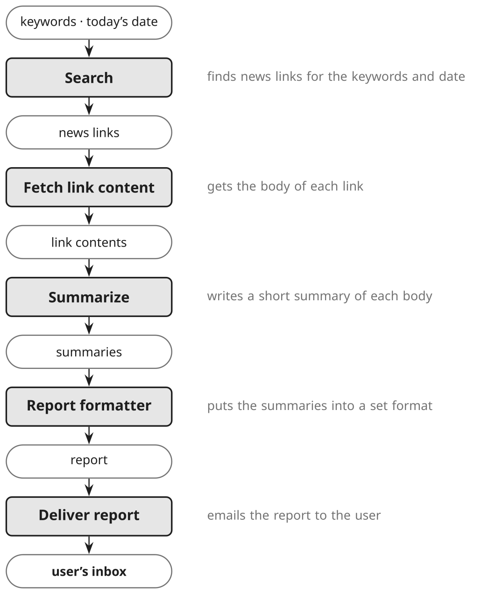

# Chapter 2: Module

Building a large system all at once is hard. So engineers take a big problem and split it into parts that can each be understood, built, and fixed on their own. Each of these parts is called a module. Three ideas matter most when designing modules: divide and conquer, abstraction, and interfaces. Keep all three in mind whenever you design a module.

## Divide and conquer

Divide and conquer means splitting a problem that is too big to solve at once into smaller problems, and solving the smaller problems one by one. You solve each one separately and put them together at the end.

To split a problem well, make each piece as independent as possible. The smaller problems should not overlap (Mutually Exclusive), and solving all of them should solve the whole problem (Collectively Exhaustive). The two conditions together are often called MECE.

## Abstraction

Abstraction means hiding a module's details. When we drive, we use "the brake." We know that pressing the pedal stops the car, but we don't think about how the hydraulics work. If every detail were exposed and you had to know all of them to use anything, anyone would quickly be overwhelmed. Hiding details makes the whole system much easier to build and to use.

What to hide and what to expose should depend on how the module will be used. Here is an example. Bob and Alice both keep a diary every day. Bob writes in whichever notebook is at hand, without sorting them by year or month. Alice keeps a separate notebook for each year and month. When they want to find out what happened on a particular day, Alice simply opens the notebook for that date. Bob has to remember roughly which notebook was used when, or else go through every one of them. They both keep the same kind of diary, but only Alice's way fits the job of finding entries by date.

AI agents have a similar case. Say an AI agent has a "diary" feature that records information about you. If the module behind this feature is well abstracted, it will offer a way to fetch the entries for a given date. If it isn't, and the only option is to fetch every entry at once, the agent has to go through all the entries one by one to find the one it wants. It wastes tokens reading everything it doesn't need.

So how you abstract a module depends on how the system will be used, and a poor abstraction can make the system work inefficiently.

Sometimes an abstraction leaks. This happens when you have to know the hidden details to use a module properly. Take the brake again. In a car without ABS (anti-lock brakes), slamming the brake on an icy road locks the wheels and the car skids. So the driver has to press the brake in short bursts. The promise "press it and the car stops" is no longer enough; the driver also has to know how the wheels lock. Here the brake abstraction leaks. The more an abstraction leaks, the more its users have to know, and the less it helps.

## Interface

A system contains many modules, and the output of one module often becomes the input of another. That makes communication between modules essential. An interface is an agreement on how two modules talk to each other. Think of it as a definition of what one side sends and what the other side returns. A wall socket is a good example. Any lamp lights up in any socket because the two have agreed in advance on the shape of the plug and the voltage.

Interfaces are what let you swap parts. With a well-defined interface, you can replace or improve one module without touching the rest of the system. Without one, changing a single module means also fixing the other modules connected to it.

## Example: a news summary report system

Imagine a system that, every morning, automatically summarizes the day's news on keywords you care about, turns the summaries into a report, and sends it to you. Trying to solve this all at once feels daunting, but with divide and conquer you can split it into five modules, as in the figure below. Starting this flow at a set time every morning is left to a tool outside the system, such as the operating system's scheduler.

Here is how the three ideas apply to this system.

- Divide and conquer: Each module solves only one problem. The search module only finds news links; the summarize module only summarizes. The five modules don't overlap (Mutually Exclusive), and when all five work, the whole problem is solved (Collectively Exhaustive).

- Abstraction: The report formatter doesn't need to know which AI model the summarize module uses or what its prompt is. It only needs to know that it receives summaries.

- Interface: The rounded boxes in the figure, the data passed between modules, are the interfaces. For example, if the fetch module and the summarize module agree on the format of "link contents" (title, body, source URL), you can later switch the AI model used for summarizing without changing any other module.

## Agentic coding and modules

Thinking in modules matters even more when you work with an AI. In agentic coding, it is tempting to describe the whole system and ask for it in a single request. But that causes two problems.

First, the AI may build the whole system without splitting it into enough modules. Second, when you want to change a system made from a simple prompt, it is very hard to give follow-up instructions, because you have no idea how the agent split the system into modules. If you keep adding requirements in this state, the system keeps growing while you understand less and less of how it works. The system becomes complicated. Chapter 3 looks at why systems so easily become complicated in agentic coding.
