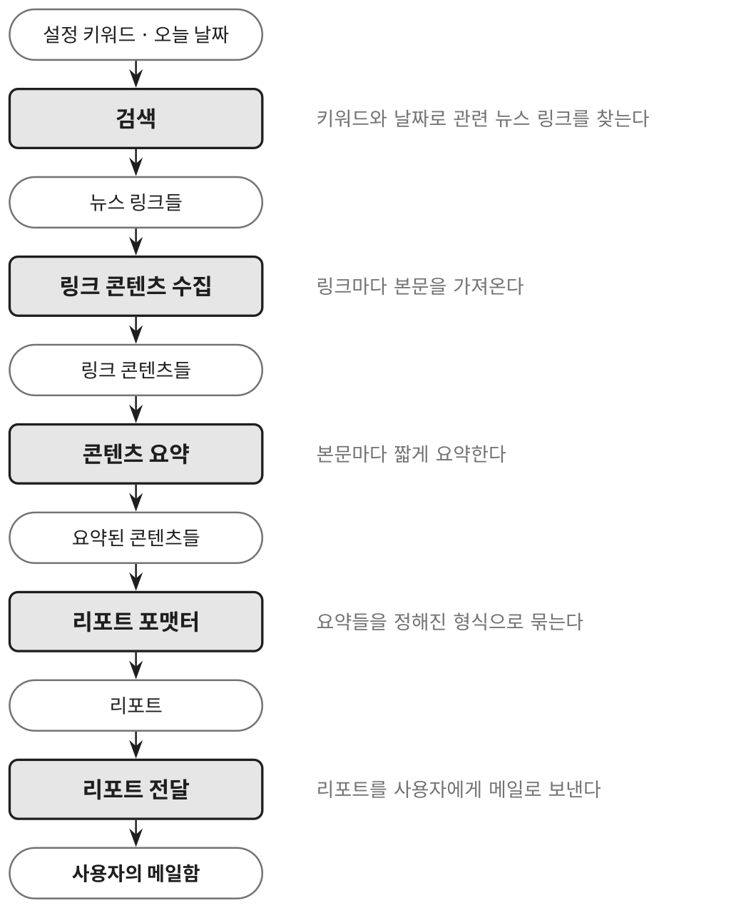

# Chapter 2: 모듈

거대한 시스템을 한 번에 만드는 것은 어렵다. 그래서 엔지니어는 큰 문제를 각각 따로 이해하고, 만들고, 고칠 수 있는 부분으로 나눠서 다룬다. 이렇게 나눈 하나의 단위를 '모듈'이라고 한다. 모듈을 설계할 때 중요한 개념이 세 가지 있다. 바로 분할 정복, 추상화, 인터페이스다. 모듈을 설계할 때는 이 세 개념을 늘 염두에 두어야 한다.

## 분할 정복 (Divide and conquer)

분할 정복이란 한 번에 해결하기에는 너무 큰 문제를 작은 문제들로 나누고, 작은 문제들을 하나씩 해결하는 것을 말한다. 각각의 문제를 따로 해결한 뒤 마지막에 합친다.

문제를 잘 나누려면 각 문제가 최대한 독립적이어야 한다. 작은 문제들은 서로 겹치지 않아야 하고(Mutually Exclusive), 작은 문제들이 모두 해결되면 전체 문제도 해결되어야 한다(Collectively Exhaustive). 두 조건의 앞 글자를 따서 MECE라고 부르기도 한다.

## 추상화 (Abstraction)

추상화는 모듈의 세부 사항을 감추는 것을 말한다. 운전할 때 우리는 "브레이크"를 쓴다. 페달을 밟으면 차가 멈춘다는 것만 알 뿐, 유압 장치가 어떻게 작동하는지는 생각하지 않는다. 모든 세부 사항이 드러나 있고 그것을 다 알아야만 쓸 수 있다면 누구든 금세 혼란에 빠진다. 세부 사항을 감추면 전체 시스템을 개발하고 사용하기가 훨씬 쉬워진다.

무엇을 감추고 무엇을 드러낼지는 모듈을 어떻게 쓸지에 따라 정해야 한다. 예를 들어 보자. 철수와 영희는 둘 다 매일 일기를 쓴다. 철수는 일기장을 연도나 월로 구분하지 않고 손에 잡히는 대로 적었고, 영희는 연도별, 월별로 일기장을 나눠 기록해 두었다. 특정 날짜에 무슨 일이 있었는지 알아보려 할 때, 영희는 그 날짜의 일기장을 바로 펼치면 된다. 반면 철수는 자신이 언제쯤 어느 일기장을 썼는지 기억해 내거나, 모든 일기장을 뒤져 봐야 한다. 둘 다 같은 일기를 쓰지만, 날짜로 기록을 찾는 쓰임새에는 영희의 방식만 맞는다.

AI 에이전트에서도 비슷한 예를 들 수 있다. AI 에이전트에 나에 대한 정보를 기록하는 '일기' 기능이 있다고 해 보자. 이 기능을 맡은 모듈이 잘 추상화되어 있다면, 특정 날짜의 기록을 찾아 주는 기능이 있을 것이다. 반대로 추상화가 제대로 되어 있지 않아 모든 기록을 한꺼번에 가져오는 기능밖에 없다면, AI 에이전트는 원하는 기록을 찾기 위해 모든 기록을 일일이 뒤져 봐야 한다. 그만큼 불필요한 내용을 읽느라 토큰을 낭비하게 된다. 이처럼 모듈을 어떻게 추상화할지는 시스템을 어떻게 사용할지에 따라 달라지고, 추상화를 잘못하면 시스템이 비효율적으로 동작할 수 있다.

추상화가 새는(leaky) 경우도 있다. 감춰 둔 세부 사항을 알아야만 모듈을 제대로 쓸 수 있을 때다. 다시 브레이크를 예로 들어 보자. ABS(잠김 방지 장치)가 없는 차로 빙판길을 달릴 때 브레이크를 꾹 밟으면 바퀴가 잠겨 차가 미끄러진다. 미끄러지지 않으려면 브레이크를 여러 번 나눠 밟아야 한다. 이러한 지식은 정지 마찰력과 운동 마찰력에 대한 개념을 알아야 한다. 즉, "브레이크를 밟으면 멈춘다"는 것 이외에 브레이크가 차를 멈추게 하는 원리 및 마찰력에 대한 지식까지 알고 있어야 하는 것이다. 이때 '브레이크'라는 추상화는 샌다. 새는 추상화가 많을수록 사용자가 알아야 할 것이 늘어나고, 추상화의 장점은 줄어든다.

## 인터페이스 (Interface)

시스템 안에는 여러 모듈이 있고, 한 모듈의 결과가 다른 모듈의 입력이 되기도 한다. 그래서 모듈 간의 소통은 필수적이다. 인터페이스는 두 모듈이 어떻게 소통할지 정한 약속이다. 한쪽이 무엇을 보내고 다른 쪽이 무엇을 돌려주는지를 정해 둔 것이라고 보면 된다. 벽의 콘센트가 좋은 예다. 어떤 스탠드든 어떤 콘센트에 꽂아도 켜지는 것은, 둘이 플러그의 모양과 전압에 미리 합의했기 때문이다.

인터페이스가 있기에 부품을 갈아 끼울 수 있다. 인터페이스가 잘 정의되어 있으면 전체 시스템에서 특정 모듈만 바꾸거나 개선할 수 있다. 반대로 인터페이스가 제대로 정의되어 있지 않으면, 모듈 하나를 바꾸려 해도 그 모듈과 연결된 다른 모듈까지 함께 고쳐야 한다.

## 예시: 뉴스 요약 리포트 시스템

매일 아침 관심 있는 키워드에 대한 그날의 뉴스를 자동으로 요약해 리포트로 만들고, 사용자에게 보내 주는 시스템을 생각해 보자. 이 일을 한 번에 해결하려 하면 막막하지만, 분할 정복을 적용하면 아래 그림처럼 다섯 개의 모듈로 나눌 수 있다. 매일 아침 정해진 시간에 이 흐름을 시작하는 일은 이 시스템이 아니라 운영체제의 예약 실행 기능 같은 바깥 도구에 맡긴다고 하자.

앞서 다룬 세 개념은 이 시스템에 다음과 같이 적용되었다.

- 분할 정복: 각 모듈은 하나의 문제만 해결한다. 검색 모듈은 뉴스 링크를 찾는 일만, 콘텐츠 요약 모듈은 요약하는 일만 한다. 다섯 모듈은 서로 겹치지 않고(Mutually Exclusive), 다섯 모듈이 모두 동작하면 전체 문제가 해결된다(Collectively Exhaustive).

- 추상화: 리포트 포맷터 입장에서는 콘텐츠 요약 모듈이 어떤 AI 모델을 쓰는지, 프롬프트가 무엇인지 알 필요가 없다. 요약된 콘텐츠를 받는다는 것만 알면 된다.

- 인터페이스: 그림의 둥근 칸, 즉 모듈 사이를 오가는 데이터가 인터페이스다. 예를 들어, 링크 콘텐츠 수집 모듈과 콘텐츠 요약 모듈이 "링크 콘텐츠"의 형식(제목, 본문, 출처 URL)에 합의해 두면, 나중에 요약에 쓰는 AI 모델을 바꾸더라도 다른 모듈은 고칠 필요가 없다.

## 에이전틱 코딩과 모듈

모듈로 나누어 생각하는 습관은 AI와 함께 일할 때 더욱 중요해진다. 왜냐면 에이전틱 코딩을 할 때는 시스템 전체를 한 번에 묘사해서 요청하게 되기 때문이다. 하지만 그러면 두 가지 문제가 생긴다.

첫째, AI가 모듈을 충분히 만들지 않고 전체 시스템을 구성할 수가 있다. 둘째, 단순한 프롬프트로 만든 시스템을 고치고 싶을 때 개발자가 에이전트가 만든 시스템이 어떻게 모듈화가 되어 있는지 전혀 이해를 하지 못하고 있기 때문에 후속 명령을 내리기가 매우 어렵다. 이러한 상태에서 계속 요구사항을 추가하다 보면 시스템은 커지는데 대체 어떻게 동작하는지 전혀 이해를 하지 못하는 상태가 된다. 시스템이 난해해지는 것이다. 3장에서는 왜 에이전틱 코딩에서 시스템이 쉽게 난해해지는지 알아보겠다. 
